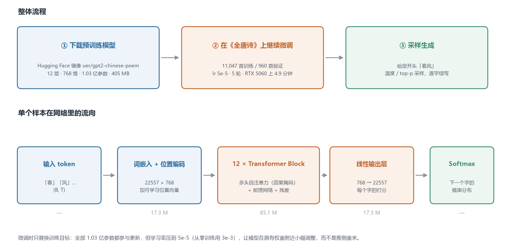
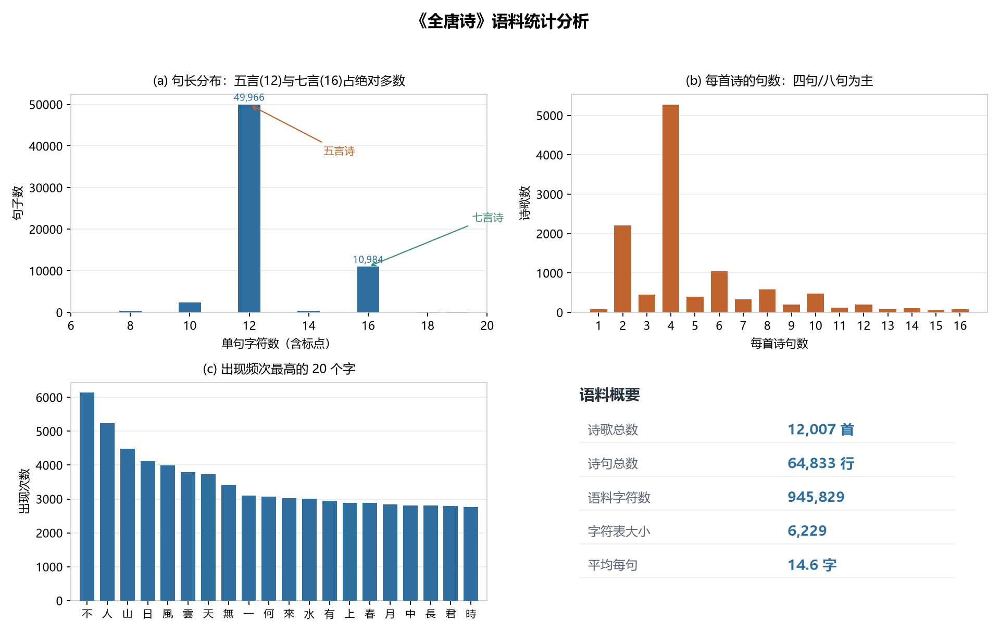
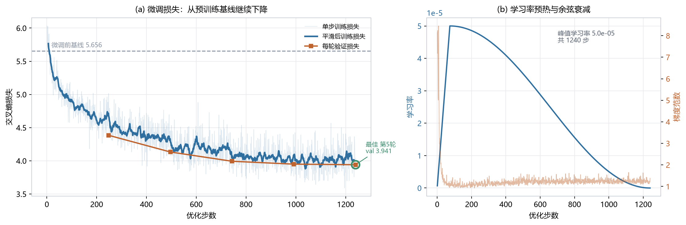
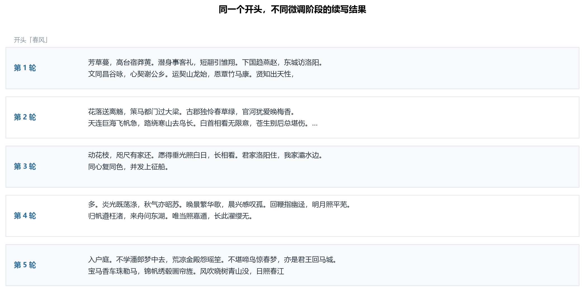
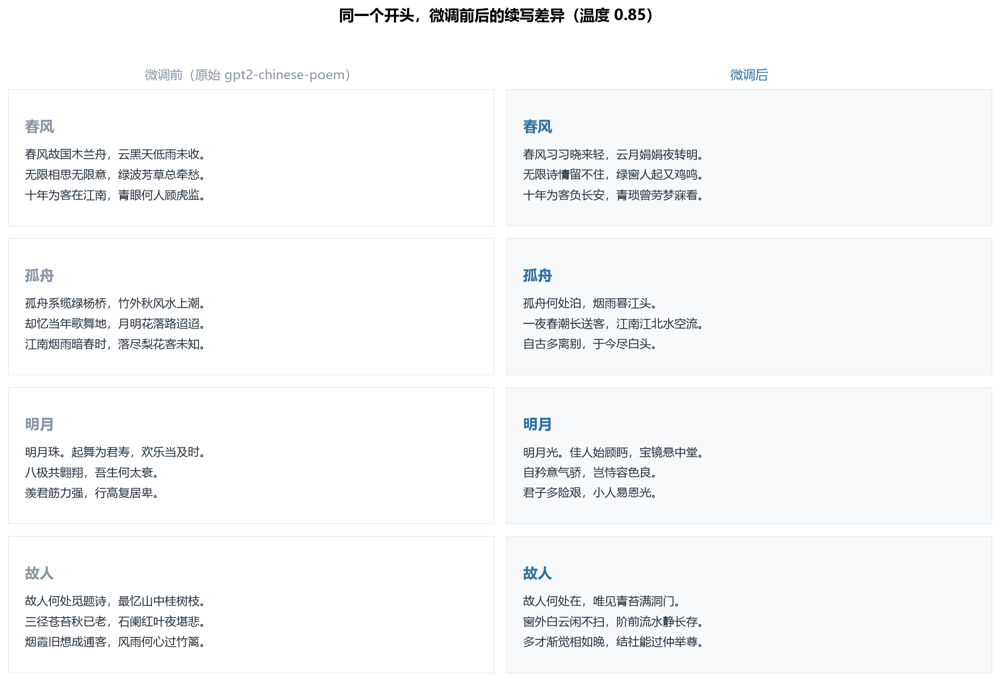
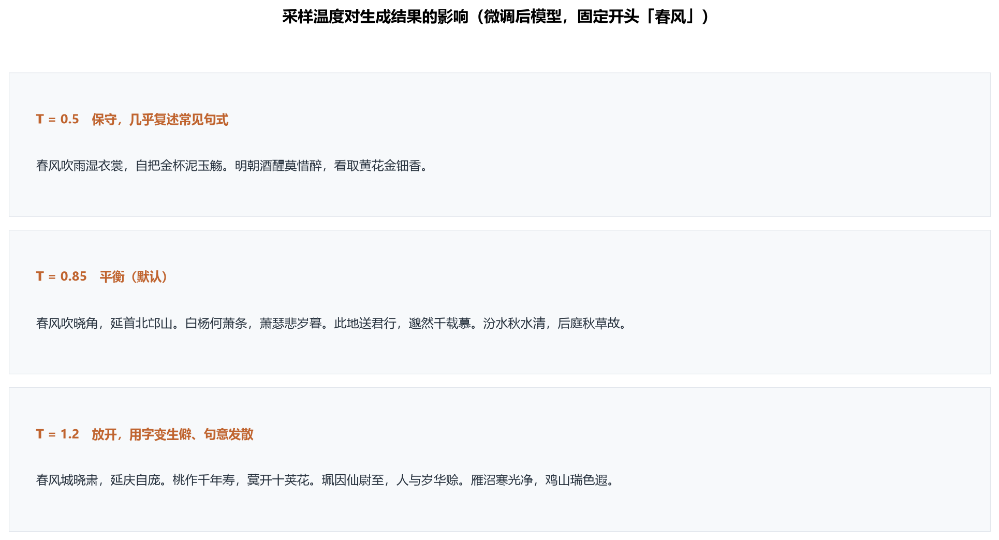
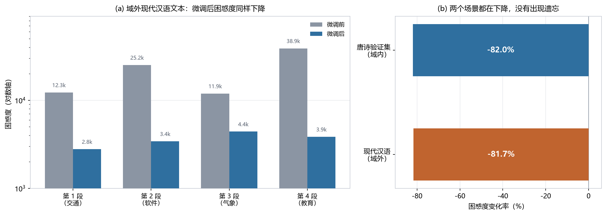
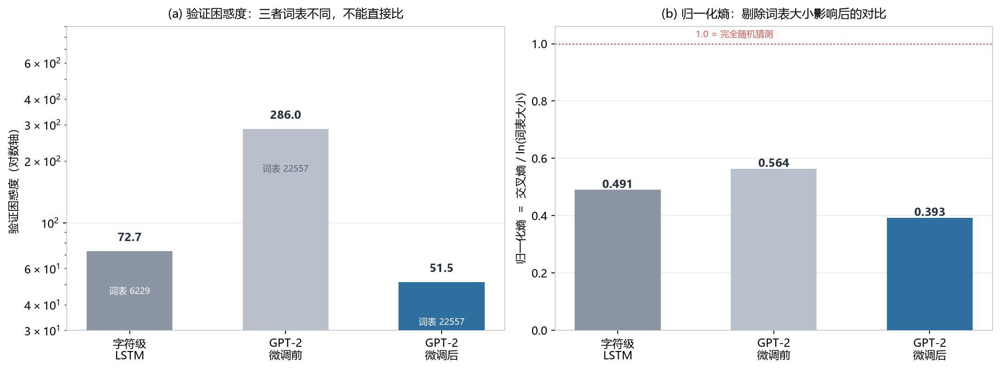

# 微调 gpt2-chinese-poem 生成唐诗

> 人工智能课程作业 · 2026 秋季学期

---

## 摘要

本次作业选了 Hugging Face 上的 `uer/gpt2-chinese-poem`（1.03 亿参数的 GPT-2 解码器，在古诗上预训练过），用《全唐诗》12,007 首做继续预训练，让它从"会写古体诗"变成"会写唐诗"。

验证集交叉熵从 5.656 降到 3.941，困惑度从 286.0 降到 51.5，下一个字的 Top-1 准确率从 18.5% 提到 33.0%，在 RTX 5060 Laptop 上用时 4.8 分钟。给定开头"春风"，微调后的模型写出：

> 春风入户庭。不学潘郎梦中去，荒凉金殿怨瑶笙。
> 不堪啼鸟惊春梦，亦是君王回马城。

---

## 1 任务定义

作业要求在模型社区找一个小模型自己训练。我选的是古诗生成：`chinese-poetry` 项目公开了《全唐诗》全文，不用自己标注；语言模型有困惑度、准确率这类客观指标，不依赖人工打分；生成结果读起来像不像诗，肉眼就能判断，方便做定性分析。

具体设定是字符级自回归语言模型，给定前文预测下一个字，训练目标为最小化交叉熵

$$\mathcal{L} = -\frac{1}{T}\sum_{t=1}^{T}\log p_\theta(x_t \mid x_1, \dots, x_{t-1})$$

---

## 2 模型

### 2.1 来源

在 Hugging Face 上按 `text-generation` + `zh` 筛选，再按下载量排序，`uer/gpt2-chinese-poem` 是中文古诗方向上用得最多的一个，作者是 UER-py 团队。权重以 PyTorch 格式公开，五个文件共 405 MB：

```
config.json  vocab.txt  tokenizer_config.json  special_tokens_map.json  pytorch_model.bin
```

`huggingface.co` 在国内经常连不上，实际下载走的是镜像 `hf-mirror.com`，速度约 5.7 MB/s，71 秒下完。下载脚本见 `src/download_model.py`。

### 2.2 结构

标准 GPT-2 解码器，规模属于小模型一档：

| 项目 | 数值 |
|---|---|
| 层数 | 12 |
| 隐藏维度 | 768 |
| 注意力头 | 12 |
| 前馈维度 | 3072 |
| 上下文长度 | 1024 |
| 词表大小 | 22,557（字符级） |
| 总参数量 | 103,166,208（约 1.03 亿） |



*图 1　整体流程（上）与单个样本在网络中的流向（下）*

它的分词器不是 GPT-2 原版的 BPE，而是中文 BERT 的字符级分词器，一个汉字对应一个 token，词表里 22,557 个条目绝大多数是单个汉字和标点。对古诗来说这反而合适，因为诗的韵律本来就以字为单位，把"明月"捆成一个不可拆的符号没什么好处。

### 2.3 微调前的状态

拿原始权重直接生成（温度 0.85，开头"春风"）：

> 春风故国木兰舟，云黑天低雨未收。
> 无限相思无限意，绿波芳草总牵愁。
> 十年为客在江南，青眼何人顾虎监。

格式完全正确，用词也有古意。也就是说"写古体诗"这件事它本来就会，微调要做的不是教它写诗，而是把风格往唐代、往这 1.2 万首的范围里再收一收。既然只是微调风格，学习率就不能大。

---

## 3 数据

### 3.1 语料

来源是 GitHub 上的 `chinese-poetry/chinese-poetry`，用了《全唐诗》的 12 个分卷。清洗时只保留纯中文行，丢掉夹杂异体符号和缺字的行，剩下：

| 项目 | 数值 |
|---|---|
| 诗 | 12,007 首 |
| 句 | 64,833 句 |
| 字符 | 945,829 字 |
| 平均每首 | 68.2 字 |



*图 2　语料的基本统计（基于原始繁体文本）*

句长分布（图 2b）几乎全部落在 12 字和 16 字，对应五言（5+5+2 个标点）和七言（7+7+2）。这个规律后面会反复出现：模型写出来的句子长度极少出错，因为它只要学会"几个字一个句号"就够了。

### 3.2 繁简转换

《全唐诗》原文是繁体，而 `gpt2-chinese-poem` 的 BERT 词表虽然收录了繁体字，预训练语料却以简体为主。我先做了个实测：

| 输入 | 繁简情况 | 困惑度 |
|---|---|---|
| 床前明月光，疑是地上霜。 | 繁简通用 | 36.9 |
| 秦川雄帝宅，函谷壯皇居。 | 繁体 | 769.6 |

同一批诗，只因为字形不同，困惑度差了 20 倍。整份语料直接喂进去，验证集困惑度是 16,197，已经很接近完全随机（22,557 个字均匀分布时困惑度就是 22,557）。

原因是繁体字在词表里有对应的 embedding 向量，但这些向量在预训练时几乎没被梯度更新过，基本停在随机初始化的水平。模型看到"壯"就像看到一个没见过的字。

用 `zhconv` 做繁→简转换，12,007 首里有 12,005 首被改写，验证集困惑度从 16,197 掉到 286.0：

| 语料形式 | 验证困惑度 |
|---|---|
| 原始繁体 | 16,197.7 |
| 转简体 | 286.0 |

这一步大概是我在整个作业里花时间最多的地方。它说明微调不是把数据丢进去就行——预处理是否和预训练分布对齐，决定了后面所有工作有没有意义。不转简体直接训，模型会拿大部分容量去认繁体字，后面测出来的东西都不能信。

代价也说一下：繁简转换会丢掉一部分异体字信息，比如"後"和"后"合并了。真做古籍研究这不合适，但作为语言模型实验，统一字形是合理取舍。

### 3.3 格式与划分

每首诗压成一行（去掉句内换行，保留标点），诗与诗之间插入 `[SEP]`：

```
秦川雄帝宅，函谷壮皇居。绮殿千寻起，离宫百雉余。……绮疏。[SEP]岩廊罢机务，……
```

`[SEP]` 有两个用途，一是告诉模型一首诗到此为止，二是生成时可以作为停止符。

划分按"首"切分，不是按 token 块切。这里容易踩坑：如果先把全文拼成一条长流再切块，同一首诗的前半段可能进训练集、后半段进验证集，模型只要背下上半句就能猜中下半句，验证集指标会虚高。

| | 诗数 | 字符 | token |
|---|---|---|---|
| 训练集 | 11,047 | 808,466 | 764,278 |
| 验证集 | 960 | 72,532 | 68,692 |

---

## 4 微调方案

### 4.1 继续预训练而非指令微调

微调有两种常见形态。指令微调把任务写成问答对，教模型听懂指令，需要构造指令数据；继续预训练直接用目标领域文本接着训，让模型适应这个领域的用词和句式，不需要额外标注。

古诗生成没有"指令"这回事，我们不要它回答，只要它往下写。所以用继续预训练，训练目标和预训练阶段完全一致，只换了数据。

### 4.2 学习率

这大概是微调和从零训练差别最大的地方。从零训练时峰值学习率用 3e-3，这里用 5e-5，小了 60 倍。

原因是随机初始化的权重本身没有意义，可以大步走；预训练权重已经在一个不错的位置上，步子大了就会一步跨出去，把原来学的东西冲掉，这正好是灾难性遗忘的成因。小学习率相当于在原有解附近做局部搜索。

完整配置：

| 超参 | 取值 | 说明 |
|---|---|---|
| 峰值学习率 | 5e-5 | 余弦衰减，前 6% 步数线性预热 |
| 优化器 | AdamW (β=0.9, 0.95) | 权重衰减 0.01 |
| batch size | 4 × 梯度累积 2 = 8 | 受 8 GB 显存限制 |
| 序列长度 | 384 | 一首诗平均 68 字，384 能装下 5 首左右 |
| 轮数 | 5 | 共 1,240 步 |
| 梯度裁剪 | 1.0 | |
| 混合精度 | bfloat16 | 显存占用从约 6 GB 降到 4.5 GB |

### 4.3 两个坑

第一个是 `bad allocation`。最初用 batch 8 × 序列 512，跑到一半报 `RuntimeError: bad allocation`。这个错不是显存不足（显存不足会报 CUDA out of memory），是 CPU 侧内存分配失败。机器物理内存 15.7 GB，当时只剩 3.6 GB 可用。把 batch 降到 4、序列降到 384 之后稳定了。另外评估阶段原来要把 logits 转成 fp32 再算准确率，这一步每次会多分配约 370 MB 的临时张量，改成直接对 bf16 的 logits 取 argmax 之后省掉了。

第二个是生成的样本太短。模型有时在"春风"两个字之后就吐 `[SEP]` 结束，日志里的样本变成"春风，看取霜。"这种残句，完全看不出能力变化。原因是采样没设长度下限，而模型认为这个位置该结束了。加上 `min_new_tokens=44` 之后才稳定。

---

## 5 训练结果



*图 3　微调过程：(a) 损失曲线 (b) 学习率与梯度范数*

| 轮次 | 训练损失 | 验证损失 | 验证困惑度 | Top-1 准确率 | 耗时 |
|---|---|---|---|---|---|
| 0（微调前） | — | 5.656 | 286.0 | 18.5% | — |
| 1 | 4.906 | 4.384 | 80.2 | 27.4% | 55 s |
| 2 | 4.410 | 4.133 | 62.4 | 30.6% | 54 s |
| 3 | 4.186 | 3.993 | 54.2 | 32.4% | 54 s |
| 4 | 4.064 | 3.950 | 51.9 | 32.9% | 54 s |
| 5 | 4.020 | 3.941 | 51.5 | 33.0% | 54 s |

合计 4.8 分钟。

下降主要发生在第一轮，困惑度从 286 砍到 80，降了 72%，后面四轮加起来只从 80 降到 51。字形、标点、句长这些表层规律很快就能学会，磨到最后的是更细的用词分布。第 4 轮到第 5 轮只降了 0.009，收益已经很小，再训下去大概率是浪费，除非换更大语料。

训练损失和验证损失几乎重合，最后两轮训练损失 4.02、验证损失 3.94，验证反而低一点。没有过拟合的迹象，原因大概是模型见过的古诗远不止这 1.2 万首，不需要靠背，dropout（0.1）也在起作用。



*图 4　固定开头「春风」，各轮次模型的续写结果*

图 4 是同一个开头在不同轮次下的输出。这里没有出现从乱码到成句的突变，第 1 轮就已经是完整的句子，因为它继承了一个会写诗的大脑。微调改变的是风格倾向：第 1 轮五言为主，用词偏古奥（"下国趋燕赵，东城访洛阳"），像初唐应制诗；第 2 轮转向七言，"花落送离觞，策马都门过大梁"是典型的送别题材；到第 5 轮出现"宝马香车珠勒马，锦帆绣毂画帘旌"这种密集铺陈，是《全唐诗》里宫廷宴饮一类作品的高频写法。

---

## 6 生成效果分析

### 6.1 微调前后



*图 5　同一开头，微调前后的续写差异（温度 0.85）*

| 开头 | 微调前 | 微调后 |
|---|---|---|
| 春风 | 春风故国木兰舟，云黑天低雨未收。 | 春风习习晚来轻，云月娟娟夜转明。 |
| 孤舟 | 孤舟系绿杨桥，竹外秋风冰上潮。 | 孤舟何处泊，烟雨暮江头。 |
| 明月 | 明月珠。起舞为君寿，欢乐当及时。 | 明月光。佳人始顾眄，宝镜悬中堂。 |
| 故人 | 故人何处觅题诗，最忆山中桂树枝。 | 故人何处在，唯见青苔满洞门。 |

变化有两处比较明显。一是句子变短了，微调后更倾向五言（"孤舟何处泊""故人何处在"），微调前偏七言和散句，这和语料统计吻合，《全唐诗》里五言数量确实占优。二是用词更像唐诗，微调前"木兰舟""云黑天低"更接近宋词的意境，微调后"佳人始顾眄，宝镜悬中堂""唯见青苔满洞门"是唐代宫怨、隐逸题材的常见意象。后一条比较主观，主要是阅读感受。

### 6.2 温度



*图 6　采样温度对生成结果的影响（固定开头「春风」）*

温度 T 控制采样时概率分布的锐化程度，$p_i \propto p_i^{1/T}$。

T = 0.5 时分布被锐化，模型几乎总选概率最高的字，输出保守、句式重复率高，但不容易出语法错误。T = 0.85 是本次的默认值，工整和变化兼顾。T = 1.2 时分布被压平，生僻字大量出现，句意开始跳脱，会出现字都对、连起来读不通的情况。

对写诗来说这是核心参数，太保守没有诗味，太放开会失去可读性。报告里展示的样本都用 0.85，只有这张图刻意取了三个不同的温度。

### 6.3 失败案例

温度调到 1.2 时，问题暴露得很明显：

> 春风城晓肃，延庆自庇。
> 桃作千年寿，宴开十英花。
> 珮因仙尉至，人与岁华赊。

"延庆自庇"读不通（"延庆"是今天的北京延庆区，纯属凑字），"宴开十英花"也不成词。每句的句长、标点、平仄位置都对，但整首诗讲不出一个连贯的意思。

温度低一点时，这种断裂被高频搭配掩盖了，表面读起来通顺；一旦放开采样，模型不知道自己在写什么就露出来了。它能写出漂亮的单句，却写不出有起承转合的诗篇，因为篇章结构需要长程的语义规划，而字符级模型在这方面基本没学到东西。

---

## 7 灾难性遗忘检测

### 7.1 方法

微调有个经典风险：模型为了适应新数据把原来学到的东西覆盖掉，在新领域上升、在旧领域断崖下跌，这叫灾难性遗忘。

检测方法很直接：准备一份与唐诗完全无关的现代汉语文本，比较微调前后的困惑度。如果这个数字暴涨，说明模型退化了。

我写了四段共 681 字的现代汉语说明文，主题分别是城市轨道交通、软件开发、气象预报、教育评价，文体是规范的技术说明文，与唐诗在词汇、句法、语域上都没有重叠。原文在 `data/ood_modern_zh.txt`。

### 7.2 结果



*图 7　域外现代汉语文本上的困惑度变化*

| 测试集 | 微调前 | 微调后 | 变化 |
|---|---|---|---|
| 唐诗验证集（域内） | 286.0 | 51.5 | −82.0% |
| 现代汉语（域外） | 19,463.5 | 3,569.9 | −81.7% |

没有出现灾难性遗忘，两个场景的下降幅度几乎一样。

### 7.3 解释

结果看起来反直觉，想清楚是合理的。原模型本来就不擅长现代汉语，19,463 的困惑度意味着它几乎完全预测不了，这个数字已经很接近完全随机的 22,557。它从一开始就是个古诗专用模型，没有多少一般中文能力可以被遗忘。而且微调这 5 轮学到的不只是"诗怎么写"，还有"汉字之间怎么接"这种底层统计，这部分对现代汉语同样适用。再加上只跑 5 轮、学习率 5e-5，参数移动的幅度很小，如果训 50 轮、学习率 1e-3，结论很可能完全不同。

所以灾难性遗忘更像是"微调强度 × 领域差异"的函数，在领域接近、微调温和的条件下可以不出现。

不过这个实验的局限也要讲清楚：域外困惑度 3,570 仍然是个很差的数字。它说明模型即便经过微调，依然只是个写诗的模型，不该指望它做别的事。

---

## 8 一个对照：同语料的字符级 LSTM

同一份语料、同一套训练/验证划分和同样的评估方式，另外训了一个字符级 LSTM 作对照。它的用处是给上面的困惑度一个参照系，看看相同的预算下预训练权重到底值多少。

| | 字符级 LSTM | 微调 GPT-2 |
|---|---|---|
| 参数量 | 2,793,429 | 103,166,208 |
| 词表 | 6,229 | 22,557 |
| 是否用预训练权重 | 否 | 是 |
| 训练耗时 | 115 秒（40 轮） | 285 秒（5 轮） |
| 验证损失 | 4.287 | 3.941 |
| 验证困惑度 | 72.7 | 51.5 |
| Top-1 准确率 | 34.1% | 33.0% |



*图 8　两个模型的结果对比：困惑度不可直接比，归一化熵可以*

### 8.1 困惑度不能直接比

表里 LSTM 的困惑度 72.7 和 GPT-2 的 51.5 差得不多，但这个比较是错的，两者词表大小差了 3.6 倍。LSTM 只在 6,229 个字里选，GPT-2 要在 22,557 个字里选，后者的任务本来就难得多。

公平的做法是看归一化熵，也就是交叉熵除以 $\ln V$，含义是"模型还剩下多少不确定度"，1.0 表示完全瞎猜，0 表示完全确定：

$$\text{归一化熵} = \frac{\text{交叉熵}}{\ln V}$$

| 模型 | 交叉熵 | ln(V) | 归一化熵 |
|---|---|---|---|
| 字符级 LSTM | 4.287 | 8.738 | 0.491 |
| GPT-2（微调前） | 5.656 | 10.024 | 0.564 |
| GPT-2（微调后） | 3.941 | 10.024 | 0.393 |

按这个口径，微调后的 GPT-2 明显更好。比较有意思的是微调前的 GPT-2 反而不如 LSTM（0.564 对 0.491），因为它是个偏宋诗风的通用古诗模型，对这 1.2 万首唐诗还不够贴合，微调恰好把它拉近了这份语料。

### 8.2 两者的差别

LSTM 完全可控，代码每一行都看得懂，适合验证想法，但 278 万参数只能把归一化熵压到 0.491，天花板很明显。GPT-2 有 1.03 亿参数，做到 0.393，代价是必须先有一个足够强的预训练模型，而且它会带着你不想要的偏好，这个模型浓浓的宋诗味就是个例子。

---

## 9 局限

1. 模型是古诗专用的。第 7 节的域外测试显示，即使微调后，它在现代汉语上的困惑度仍有 3,570，让它写新闻、写代码、回答问题都不现实。
2. 不能控制题材和体裁。现在只接受"开头"这一个条件，没法指定"写一首关于送别的五言律诗"。要支持这种控制，得在训练数据里加体裁、题材标签做成条件生成。
3. 平仄和押韵没有显式建模。格律是硬约束，而语言模型只是"读起来像"。抽查生成结果能发现偶句韵脚经常对不上，比如"春风习习晚来轻，云月娟娟夜转明。无限诗情留不住，绿窗人起又鸡鸣"里"轻、明、鸣"还算押韵，换别的样本就未必。在解码时加格律约束应该能明显改善。
4. 语料只有 1.2 万首。《全唐诗》有近 5 万首，我只用了 12 个分卷，加大语料还能再降一些困惑度，这里受磁盘和时间限制做了取舍。
5. 繁简转换有信息损失。第 3.2 节提到转换合并了一部分异体字，对严格的古籍研究不可接受，但作为语言模型实验是必要的。
6. 评估只有困惑度和准确率。这两个指标衡量的是"预测下一个字"的能力，不等于诗写得好。要真正评估质量，需要人工评分或者引入格律、意象一致性之类的自动指标。

---

## 10 结论

这次作业下载了 `uer/gpt2-chinese-poem`（1.03 亿参数的 GPT-2），在《全唐诗》12,007 首上做了 5 轮继续预训练，用 4.8 分钟把验证困惑度从 286.0 降到 51.5，下一个字的准确率从 18.5% 提到 33.0%。

整个过程里最关键的一步其实是数据预处理。繁简字形不统一，困惑度就差 56 倍（16,197 对 286），不做这一步后面的训练等于白跑。微调之前得先搞清楚预训练模型是在什么分布上学的。

学习率不能照搬从零训练时的数值。用 5e-5 而不是 3e-3，是为了让参数在原解附近小幅移动，配合较少的轮数，模型既适应了新语料也没丢掉原来的能力，第 7 节的域外测试证实了这一点。

至于模型到底学到了什么，我的判断是它学到的是分布而不是理解。它能写出"春风两度入华堂，新粉墙高绣箔长"这样工整的句子，下一句却可能完全接不上意思。归一化熵 0.393 说明它还有 39% 的不确定度，这里面一部分是诗本身的开放性，另一部分就是它并不真的懂自己在写什么。

如果继续做下去，我会先试着加体裁和题材的条件控制，然后在解码阶段加格律约束。

---

## 附录：复现说明

### 环境

```
Python 3.13.12
torch 2.11.0+cu128
transformers 4.46.3
zhconv, numpy, matplotlib
NVIDIA RTX 5060 Laptop (8 GB) —— CPU 也可运行，约慢 8~10 倍
```

### 运行步骤

```bash
pip install -r requirements.txt

# 1. 下载预训练模型（约 405 MB，走 hf-mirror 镜像）
python src/download_model.py

# 2. 准备语料（下载《全唐诗》→ 清洗 → 繁简转换 → 划分）
python src/download_data.py
python src/prepare_gpt2_data.py

# 3. 评估微调前的基线（可选，训练时会自动跑一次）
python src/finetune.py --eval_only

# 4. 微调（约 5 分钟）
python src/finetune.py --epochs 5

# 5. 让它写诗
python src/generate_gpt2.py --prompt 春风 --n 60 --num 3

# 6. 灾难性遗忘检测（需要先完成第 4 步）
python src/eval_ood.py

# 7. 重新生成报告里的所有图
python src/plot_arch2.py        # 图 1
python src/plot_corpus.py       # 图 2
python src/plot_finetune.py ft  # 图 3、图 4
python src/plot_gen.py          # 图 5、图 6
python src/plot_ood.py          # 图 7
python src/plot_vs_lstm.py      # 图 8
```

### 目录结构

```
.
├── README.md                 本报告
├── appendix_lstm_report.md   LSTM 对照实验的完整记录
├── requirements.txt
├── assets/                   报告里的全部图表
├── data/
│   ├── raw/                  《全唐诗》原始 JSON（12 个分卷）
│   ├── gpt2/                 微调用语料（简体，已划分 train/val）
│   ├── ood_modern_zh.txt     域外现代汉语测试文本
│   ├── poetry.txt            LSTM 用的语料
│   └── stats.json            语料统计
├── models/                   gpt2-chinese-poem 权重（git 忽略，用脚本下载）
├── outputs/                  训练日志、指标 JSON、检查点
└── src/
    ├── download_model.py     下载预训练模型
    ├── download_data.py      下载《全唐诗》
    ├── prepare_data.py       清洗语料（LSTM 用）
    ├── prepare_gpt2_data.py  繁简转换 + 划分（微调用）
    ├── finetune.py           微调主脚本
    ├── generate_gpt2.py      采样生成
    ├── eval_ood.py           灾难性遗忘检测
    ├── model.py              LSTM 模型定义
    ├── train.py              LSTM 训练脚本
    └── plot_*.py             各张图的绘制脚本
```
