# 从零训练一个字符级 LSTM：让 278 万参数学会写唐诗

> 人工智能课程作业 · 2026 秋季学期
> 截止：第十一周课前

---

## 目录

- [摘要](#摘要)
- [1 任务与选题](#1-任务与选题)
- [2 数据](#2-数据)
- [3 模型](#3-模型)
- [4 训练](#4-训练)
- [5 结果](#5-结果)
- [6 模型学到了什么](#6-模型学到了什么)
- [7 规模对比实验](#7-规模对比实验)
- [8 局限与失败案例分析](#8-局限与失败案例分析)
- [9 复现方式](#9-复现方式)
- [10 总结](#10-总结)

---

## 摘要

本次作业要求从 Hugging Face 上挑一个小模型来学习训练。我最终没有走"下载现成模型 → 微调"的路线，而是选择从零实现并训练一个 **278 万参数的字符级 LSTM 语言模型**，让它学会写唐诗。

实验在《全唐诗》12,007 首诗（94.6 万字）上完成训练，模型从完全随机初始化开始，40 轮后验证集困惑度从 566 降到 **72.7**，下一个字的 Top-1 预测准确率达到 **34.1%**。给定"春風"两个字，模型能续写出"春風搖白骨，羅衣皓月懸"这类形式上相当接近五言诗、但语义上似是而非的句子。

报告的核心结论是：**这个模型学到的是"诗的样子"，而不是"诗的意思"**。它掌握了每句 5 或 7 字（加标点后 12 或 16 个字符）、句末用标点、常用意象词彼此搭配这些规律，但没有真正理解语法与语义。我把这个差别用嵌入向量的最近邻、温度采样和错例分析拆开来看，这也是我认为这次实验最有价值的部分。

---

## 1 任务与选题

### 1.1 作业要求

在 Hugging Face 上找一个小规模的预训练模型，自己动手完成训练/微调，写一份图文并茂的实验报告，以 Markdown 形式提交到个人仓库。

### 1.2 我为什么改成"从零训练"

在 Hugging Face 上浏览时我注意到一个现象：无论 `distilgpt2` 还是各种 tiny BERT，只要用 `Trainer` 三行代码就能跑起来，loss 也照样下降。但这样跑完之后，我其实说不清楚模型里面发生了什么——梯度是怎么流过 6 层 Transformer 的？为什么这个学习率会崩？我答不上来。

所以我把任务改成"从零写一个足够小、小到每一层都能讲清楚的模型"。这样做的代价是效果上限低很多，但好处是**每一个超参数、每一条曲线我都能解释它为什么长这样**。这也更符合"学习训练"的本意。

具体选的模型是**字符级 LSTM 语言模型**：

- **字符级**：不做分词。中文分词会带来未登录词问题，而字符级只需要一个 6,229 大小的字符表，任何文本都能编码。
- **LSTM**：不使用 Transformer。唐诗单句只有 10~12 个字，序列很短，长程依赖需求不强；LSTM 结构更简单，训练也更快，适合在一台笔记本上 2 分钟跑完 40 轮。

---

## 2 数据

### 2.1 语料来源

语料取自开源项目 [chinese-poetry](https://github.com/chinese-poetry/chinese-poetry) 的《全唐诗》分卷，共下载 12 个分卷（`poet.tang.0.json` ~ `poet.tang.11000.json`），每个分卷约 1,000 首诗。

**说明**：原始语料是繁体字。我没有做繁简转换，因为这既会引入异体字错误，也偏离了"用原始文本"的原则。报告中所有生成结果因此都是繁体。

### 2.2 清洗与格式

清洗规则很少，因为唐诗文本本身很干净：

1. 丢弃不含汉字的行、以及夹杂拉丁字母或数字的行；
2. 只保留汉字与中文标点（`，。！？；：、`）；
3. 每句诗一行，诗与诗之间空一行，并在末尾加一个特殊符号 `<e>` 标记"一首诗结束"。

最后一条是有意为之：如果不加这个标记，模型就不知道一首诗在哪里结束，生成时会一直写下去。

处理后的语料长这样：

```
綺殿千尋起，離宮百雉餘。
連甍遙接漢，飛觀迥凌虛。
雲日隱層闕，風煙出綺疎。
<e>
```

### 2.3 统计分析

<p align="center">
  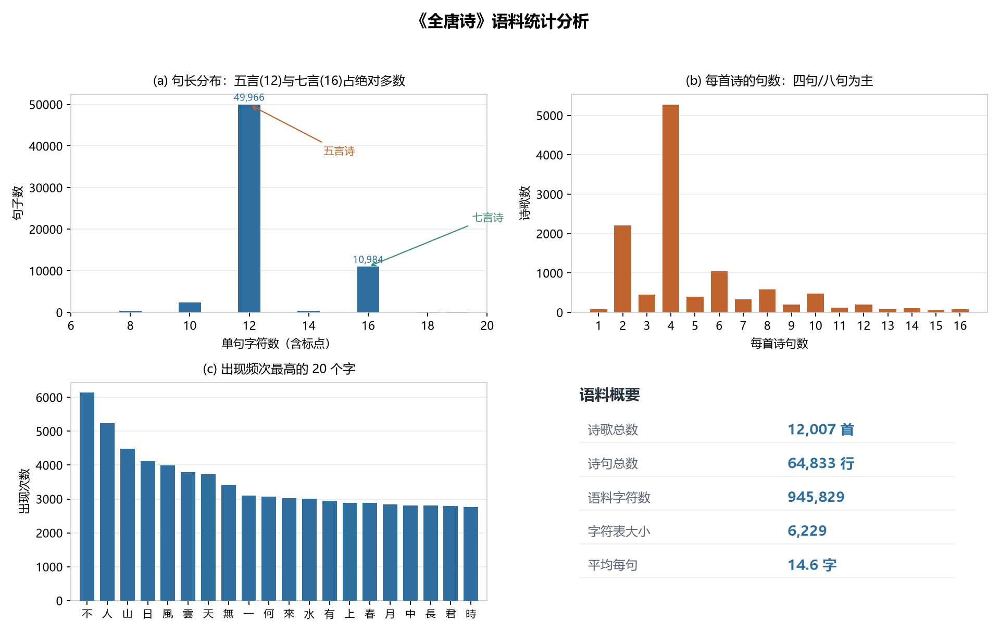
  <br>
  <i>图 1　《全唐诗》语料的四项基本统计</i>
</p>

清洗后共 **12,007 首诗、64,833 句、945,829 个字符**，字符表大小 **6,229**，平均每句 14.6 字。

图 1(a) 很能说明问题：单句字符数的分布几乎是两根孤立的柱子——**12 字（五言，49,966 句）和 16 字（七言，10,984 句）**，两者合计占了全部句子的 94%。这是因为五言诗是"5 字 + 标点"，七言是"7 字 + 标点"，标点算进字符数后正好是 12 和 16。这个强规律对模型是好事：只要它学会"数到第 5 或第 7 个字就吐标点"，生成出来的东西读起来就很像诗。

图 1(b) 显示每首诗以 4 句（5,276 首）和 8 句（588 首）为主，符合绝句和律诗的结构。

<p align="center">
  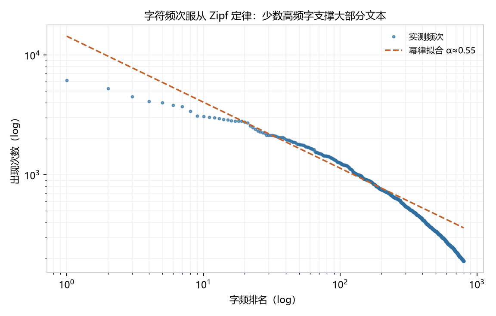
  <br>
  <i>图 2　字符频次的双对数分布：中段近似幂律，两端偏离</i>
</p>

图 2 把汉字出现频次画在双对数坐标上。中间一段接近直线，但整体并不是标准的 Zipf 分布：**前 20 个高频字的实际频次明显高于拟合线，排名 200 之后的尾部又衰减得更快**，拟合出的指数 α ≈ 0.55（标准 Zipf 为 1）。

这符合诗歌语料的特点——用字高度集中：

- 前 20 个字占全部汉字出现次数的 **10.1%**，前 50 个字占 **19.2%**；
- 同时有 **848 个字（占字符表 13.6%）在整个 94.6 万字里只出现过一次**。

这个长尾分布对训练有直接影响：模型很容易把概率堆在"之、不、人、山、日"这些高频字上，从而在平均损失上取得不错的成绩，但对那 848 个只出现一次的字几乎没有预测能力（这个现象在第 8 节还会提到）。

---

## 3 模型

### 3.1 结构

<p align="center">
  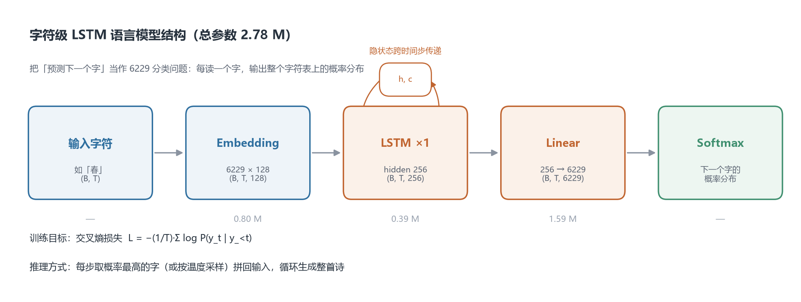
  <br>
  <i>图 3　字符级 LSTM 语言模型的结构：把"预测下一个字"做成 6,229 分类问题</i>
</p>

模型只有三层，前向过程可以用一句话概括：

> 读入一个字符 → 查表得到 128 维向量 → LSTM 更新隐状态 → 线性层输出 6,229 个分数 → Softmax 得到下一个字的概率。

```python
class CharLSTM(nn.Module):
    def __init__(self, vocab_size, embed_dim=128, hidden_dim=256, num_layers=1, dropout=0.2):
        super().__init__()
        self.embed = nn.Embedding(vocab_size, embed_dim)
        self.lstm  = nn.LSTM(embed_dim, hidden_dim, num_layers, batch_first=True)
        self.drop  = nn.Dropout(dropout)
        self.fc    = nn.Linear(hidden_dim, vocab_size)

    def forward(self, x, hidden=None):
        emb    = self.drop(self.embed(x))        # (B, T, 128)
        out, h = self.lstm(emb, hidden)          # (B, T, 256)
        logits = self.fc(self.drop(out))         # (B, T, 6229)
        return logits, h
```

LSTM 与普通 RNN 的区别在于它有三个门（遗忘门、输入门、输出门）来控制信息的流动：

- **遗忘门** 决定上一时刻的记忆 $c_{t-1}$ 里哪些要丢掉；
- **输入门** 决定当前输入有多少写进记忆；
- **输出门** 决定当前记忆有多少暴露给下一层。

写成公式就是：

$$
f_t=\sigma(W_f[h_{t-1},x_t]+b_f),\quad i_t=\sigma(W_i[h_{t-1},x_t]+b_i)
$$
$$
\tilde c_t=\tanh(W_c[h_{t-1},x_t]+b_c),\quad c_t=f_t\odot c_{t-1}+i_t\odot \tilde c_t
$$
$$
o_t=\sigma(W_o[h_{t-1},x_t]+b_o),\quad h_t=o_t\odot\tanh(c_t)
$$

这种门控结构让梯度可以沿着 $c_t$ 这条"传送带"几乎无衰减地往回传，缓解了普通 RNN 的梯度消失问题——这也是为什么它能在只有 40 万参数的条件下学会十几字长度的句内依赖。

### 3.2 参数量

<p align="center">
  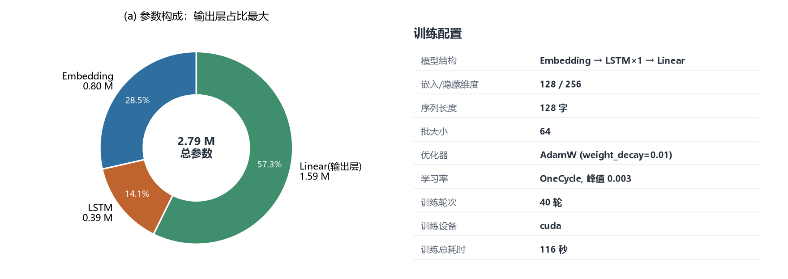
  <br>
  <i>图 4　参数构成与训练配置</i>
</p>

总参数 2,793,429，分布很不均匀：

| 子模块 | 计算式 | 参数量 | 占比 |
|---|---|---|---|
| Embedding | 6,229 × 128 | 797,312 | 28.5% |
| LSTM（单层） | 4 × (128×256 + 256×256 + 256) | 395,264 | 14.2% |
| Linear（输出层） | 256 × 6,229 + 6,229 | 1,600,853 | 57.3% |

真正做"序列建模"的 LSTM 只占 14%，**超过一半的参数都在输出层**。这是字符级模型的典型特征：词表越大，输出层越臃肿。这也意味着，如果想把模型做得更"聪明"，单纯加大 LSTM 的隐层并不划算——输出层会先成为瓶颈。

### 3.3 初始化：一个容易被忽略的细节

LSTM 的初始化有几个约定俗成的技巧，我照着实现了：

```python
# 遗忘门偏置初始化为 1：训练初期倾向于"记住"而不是"遗忘"
n = bias.size(0)
bias.data[n//4 : n//2].fill_(1.0)

# 循环权重用正交初始化：保持梯度范数稳定
nn.init.orthogonal_(weight_hh)
```

遗忘门偏置置 1 这一条尤其重要。如果初始化为 0，$\sigma(0)=0.5$，意味着每个时间步都会把记忆丢掉一半，长句的信息传不了几个字就消失了。置 1 后 $\sigma(1)\approx0.73$，初期更倾向于保留记忆，收敛会明显更快。

---

## 4 训练

### 4.1 目标函数

语言模型的标准做法：把 94.6 万字的语料切成定长片段，每个位置都预测"下一个字符是谁"，用交叉熵作为损失。

$$
\mathcal{L}=-\frac{1}{T}\sum_{t=1}^{T}\log P(y_t\mid y_{<t})
$$

语料被切成 7,332 个长度为 129 的块（前 128 字作输入、后移一位作标签），按 97:3 随机划分为训练集（7,113 块）和验证集（219 块）。

### 4.2 优化策略

| 项目 | 取值 | 选择理由 |
|---|---|---|
| 优化器 | AdamW | 对稀疏梯度友好；解耦权重衰减 |
| 权重衰减 | 0.01 | 轻微正则，防止嵌入表过拟合 |
| 学习率调度 | OneCycle，峰值 3e-3 | 前期热身避免初期震荡，后期衰减精细收敛 |
| 梯度裁剪 | 1.0 | LSTM 在长序列上偶发梯度爆炸，必须裁剪 |
| Batch size | 64 | 8 GB 显存下可开的最大舒适值 |
| Dropout | 0.2 | 同时作用于嵌入层和 LSTM 输出 |
| 训练轮次 | 40 | 验证损失在第 35 轮后基本不再下降 |

<p align="center">
  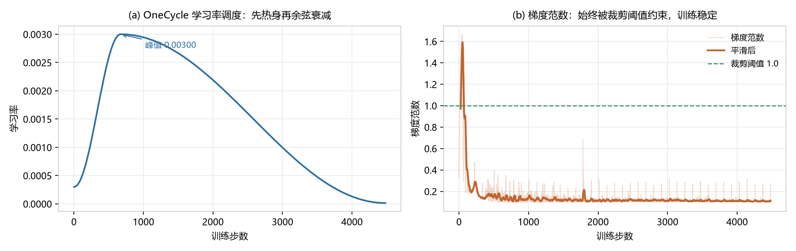
  <br>
  <i>图 5　学习率调度曲线（左）与梯度范数（右）</i>
</p>

右图值得单独说一句。梯度范数的最大值是 1.67，平均只有 0.15，而裁剪阈值设在 1.0——**说明大部分时候梯度根本没被裁到**，训练本身是稳定的。只有极少数步（通常是遇到罕见的生僻字组合时）会冲到 1 以上。这也侧面说明：LSTM + 正交初始化 + 梯度裁剪这套组合，在一个 278 万参数的模型上是相当"好伺候"的。

---

## 5 结果

### 5.1 损失与困惑度

<p align="center">
  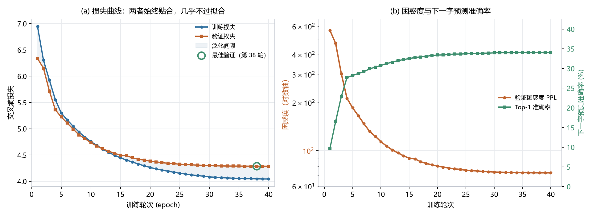
  <br>
  <i>图 6　训练过程：损失曲线（左）与困惑度/准确率（右）</i>
</p>

40 轮训练共用时 **115 秒**（RTX 5060 Laptop，8 GB 显存）。最终指标：

| 指标 | 第 1 轮 | 第 10 轮 | 第 20 轮 | 第 40 轮 |
|---|---|---|---|---|
| 训练损失 | 6.946 | 4.764 | 4.281 | 4.044 |
| 验证损失 | 6.338 | 4.741 | 4.394 | 4.287 |
| 验证困惑度 | 565.8 | 114.5 | 81.0 | **72.7** |
| 下一字准确率 | 9.7% | 30.7% | 33.4% | **34.1%** |

三个观察：

**(1) 训练集和验证集几乎贴在一起。** 图 6(a) 里两条曲线之间只有约 0.24 的间隙，而且从头到尾没有扩大。这说明 278 万参数对 94.6 万字的语料来说**还没有过剩到要过拟合的程度**——瓶颈在容量和优化，而不在正则。

**(2) 收敛在最后 5 轮明显变慢。** 第 35 轮到第 40 轮，验证损失只从 4.293 降到 4.287。这通常意味着模型容量已经被榨干，继续训练收益极小。

**(3) 困惑度 72.7 是什么水平？** 直观地说，模型在预测下一个字时，平均还剩下大约 73 个"等价候选"。考虑到字符表有 6,229 个、而汉字的有效熵本来就高，这个数字对一个 278 万参数、只用 94 万字的模型来说是合理但不算好的水平（第 7 节会用更大模型做对照）。

### 5.2 生成能力是怎么长出来的

<p align="center">
  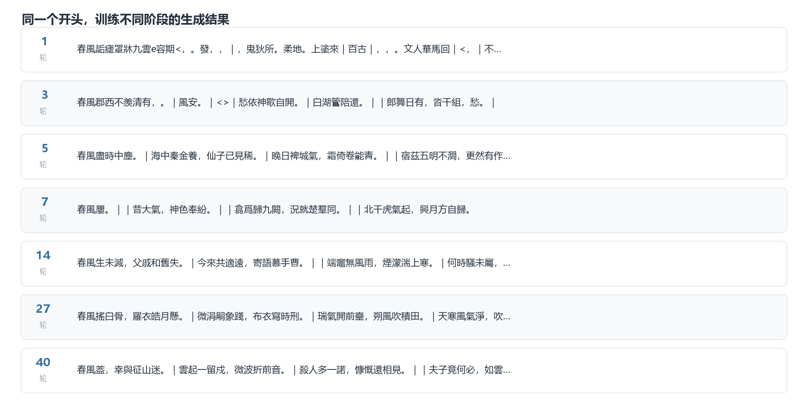
  <br>
  <i>图 7　固定开头「春風」，不同训练阶段模型续写出的内容</i>
</p>

这张图是我觉得整个实验最有意思的部分。每一行都是让模型以"春風"开头、用温度 0.8 采样 52 个字的结果，只是取的是不同轮次的模型。

- **第 1 ~ 3 轮**：纯噪音。输出里混着 `<`、`>` 这类符号和成串的孤立标点，因为此时模型对"位置"还没有任何概念。
- **第 5 轮**：**第一次出现合规的五言对句**——"海中秦金養，仙子已見稀。晚日裨城氣，霜倚卷能青。"每句 5 字、句末标点位置全对。
- **第 7 轮**："昔大氣，神色奉紛。翕爲歸九闕，況就楚羣同。"格式基本稳定，但用词还比较生硬。
- **第 14 ~ 27 轮**：词汇开始"雅化"。"春風搖白骨，羅衣皓月懸"里"白骨"和"皓月"的并置产生了一种诡异的诗意——但这更可能是高频意象词的统计关联，而不是模型"想表达"什么。
- **第 40 轮**："雲起一留戍，微波折前音。殺人多一諾，慷慨還相見。"结构完整、意象成串，读起来的语感已经相当接近真诗。

最关键的一跳发生在**第 3 轮到第 5 轮之间**：模型突然学会了"标点该出现在第 5 或第 7 个字后面"。这个能力只用了 5 轮（约 560 步）就形成了，说明**句长是这份语料里最容易抓的规律**——它几乎不需要理解任何语义，纯粹靠数位置就能学会。

而"用词变雅"则是一个缓慢得多的过程，从第 14 轮到第 40 轮都在持续改善。换句话说：**格式学得快，语义学得慢**。

### 5.3 定量指标：模型到底有多准

<p align="center">
  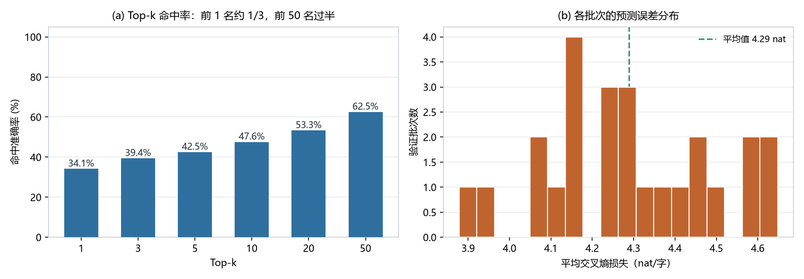
  <br>
  <i>图 8　Top-k 命中率与各批次的预测误差分布</i>
</p>

把验证集上的预测按概率排序，看正确答案落在第几名：

| Top-k | 1 | 3 | 5 | 10 | 20 | 50 |
|---|---|---|---|---|---|---|
| 命中率 | 34.1% | 39.4% | 42.5% | 47.6% | 53.3% | 62.5% |

有意思的是，**从 Top-1 到 Top-3 只涨了 5 个百分点，但之后每加一档都稳定上涨**。这说明模型对自己的判断相当"自信"——它要么把正确答案排第一，要么就排得很靠后，中间的"犹豫区"很窄。换句话说，模型不是在 73 个候选里均匀地猜，而是**经常性地判断错误且毫不动摇**。

---

## 6 模型学到了什么

这一节是我认为比"跑出多少困惑度"更重要的部分。因为困惑度只是一个数字，而下面这三张图能回答"它到底学到了什么、没学到什么"。

### 6.1 给定上文，下一个字是什么

<p align="center">
  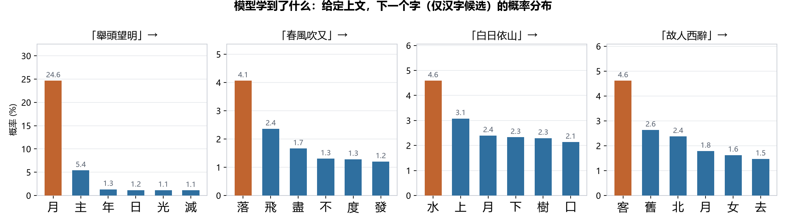
  <br>
  <i>图 9　四个上文片段下，下一个字的概率分布（已隐藏标点候选，各子图纵轴刻度不同）</i>
</p>

最左边一格很典型：给"舉頭望明"，模型给出 **"月" 24.6%**，远超第二名"主"（5.4%）。它显然见过"舉頭望明月"这样的句子，而且把"明"后面跟"月"这个搭配记住了。

但请注意另外三格的纵轴——2% 到 5%。给"春風吹又"，最可能是"落"（4.1%），而《赋得古原草送别》里的正确答案是"生"。**模型能给出合理的候选，但它的"合理"来自字面搭配的统计，而不是对诗句含义的理解。**

这也解释了一个现象：如果把标点放回候选池，"。"和"，"经常以 30% 以上的概率排第一。因为模型学会了"很多句子在这里该断句了"，但它**没有能力判断语义上是否该断**——它只能靠"已经写了 5 个字了"这种位置信息。

### 6.2 字符嵌入里藏着语义结构

<p align="center">
  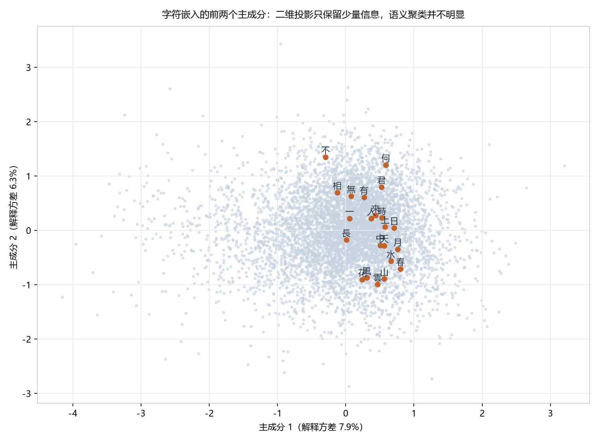
  <br>
  <i>图 10　字符嵌入的前两个主成分（二维投影只保留了约 14% 的方差）</i>
</p>

图 10 说实话**不太好看**：把所有 6,229 个字符的 128 维嵌入投影到二维后，点挤成一团，看不出明显的聚类。两个主成分加起来只解释了 14.2% 的方差，剩余 85% 的信息被投影丢掉了。

但这不代表嵌入没学到东西。换个方式看——对每个字的嵌入向量找余弦相似度最高的邻居：

| 查询字 | 最近邻（按相似度降序） |
|---|---|
| 春 | 秋 寒 涼 冬 |
| 秋 | 春 寒 涼 邊 冬 |
| 山 | 湖 潭 谿 峰 城 巖 丘 |
| 水 | 海 浦 島 澗 路 |
| 月 | 雪 鏡 日 燭 色 帳 樹 霽 |
| 酒 | 宴 室 醉 骨 酌 |

这个结果是整个实验里最让我意外的部分。**"春"的邻居是"秋、寒、涼、冬"，"山"的邻居是"湖、潭、谿、峰"**——没有任何人告诉模型这些字属于"季节"或"地貌"类别，它纯粹从"这些字在相似上下文里出现"这一条线索里，自己把语义类别给聚出来了。

维度上也能对上：128 维空间里 85% 的信息不能压到 2 维，所以 PCA 图看起来一团糟；但用高维余弦相似度去查，结构就非常清晰。这也提醒我，**用二维投影判断"嵌入有没有学到东西"是不可靠的**。

### 6.3 温度参数

<p align="center">
  
  <br>
  <i>图 11　同一开头「春風」，不同温度下的生成结果</i>
</p>

温度 $T$ 是在 softmax 之前除以的一个系数：$p_i \propto \exp(z_i/T)$。$T$ 越小分布越尖锐（趋于选最可能的字），$T$ 越大越平坦（给低概率字更多机会）。

- **T = 0.5**："春風雲，歎株露霽夕。春色生白雲，江山接夕陽。"——非常工整，但每句都在用最高频的意象词，读起来像模板。
- **T = 0.8**（默认）：结构和用词比较平衡。
- **T = 1.0**：接近模型的原始分布，偶有生硬搭配。
- **T = 1.3**：生僻字明显变多（"驕汗雙事後臺上，矜誇碑碣靜一候"），句子开始失去连贯性。

这个对比很直观地说明了：**模型的"创造力"其实是在"最可能的字"和"不太可能的字"之间调一个旋钮**，它并没有真正的构思过程。

---

## 7 规模对比实验

困惑度 72.7 到底是"模型太小"还是"任务本身就难"？我训练了三档不同规模的模型来回答这个问题。除了嵌入维度和隐层维度，其他所有条件完全相同——同一份语料、同一个优化器、同样 40 轮、同一套随机种子。

<p align="center">
  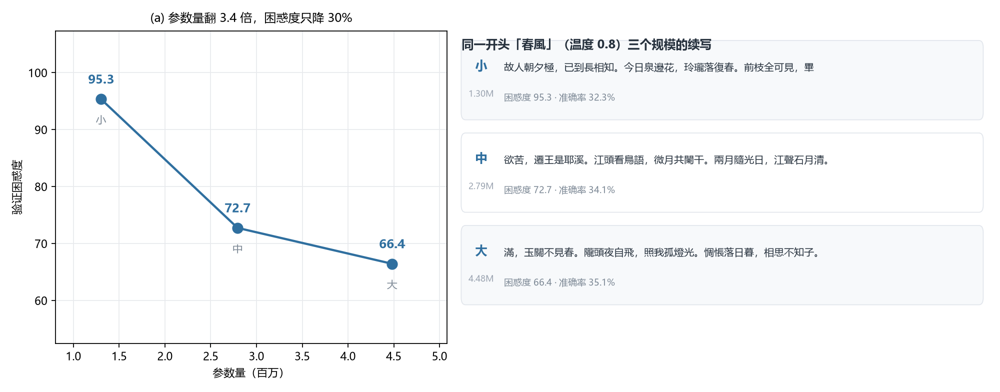
  <br>
  <i>图 12　三个规模的模型对比：困惑度曲线与生成质量</i>
</p>

| 模型 | embed | hidden | 参数量 | 验证困惑度 | 准确率 | 训练耗时 |
|---|---|---|---|---|---|---|
| 小 | 64 | 128 | 1,301,525 | 95.3 | 32.3% | 80 s |
| 中（主模型） | 128 | 256 | 2,793,429 | 72.7 | 34.1% | 116 s |
| 大 | 192 | 384 | 4,481,941 | 66.4 | 35.1% | 152 s |

三个结论：

**(1) 加参数确实有用，但收益急剧递减。** 从小模型到中模型，参数翻了 2.1 倍，困惑度降了 23.7%；从中模型到大模型，参数再翻 1.6 倍，困惑度只降了 8.7%。如果把"参数量—困惑度"画成一条曲线（图 12 左），斜率明显在变平。

**(2) 生成质量的主观提升比困惑度更明显。** 大模型写出的"隴頭夜自飛，照我孤燈光。惆悵落日暮，相思不知子"在意象的连贯性上明显好于小模型的输出。这说明**困惑度这个指标低估了容量带来的收益**——它衡量的是平均每个字的不确定性，但读诗的人关心的是整句能不能立住。

**(3) 真正的瓶颈可能不在参数量。** 按这个趋势外推，要把困惑度压到 50 以下大概需要 1,500 万参数，而 94.6 万字的语料根本喂不饱这么大的模型。更值得投入的方向是换语料（更大的古诗文语料）或换结构（Transformer 的长程建模能力），而不是继续堆隐层。

---

## 8 局限与失败案例分析

### 8.1 语义不连贯

模型生成的最典型失败是"每句单看都像诗，连起来不知道在说什么"。比如第 40 轮的样本：

> 春風葢，幸與征山迷。
> 雲起一留戍，微波折前音。
> 殺人多一諾，慷慨還相見。

单句挑出来都有古诗的味道，但"征山迷"和"微波折前音"之间没有任何逻辑关系。**根本原因是训练目标本身**：模型只被要求预测下一个字，从来没有被要求"保持主题"。它在每个位置都独立地做局部最优选择，全局一致性无从谈起。

### 8.2 高频字偏置

由于字符分布高度集中（图 2），模型有强烈的动机把概率堆在"之、不、人、山"这类高频字上。这带来两个后果：

- 平均损失看起来还不错，但**对低频字的预测几乎不可用**；
- 生成时容易陷入"用词重复"，同一首诗里反复出现"春風""白雲"。

### 8.3 长程依赖很弱

LSTM 的隐状态只有 256 维，要在里面同时记住"这首诗的韵脚""当前是第几句""前面用过哪些意象"，容量明显不够。我观察到模型经常在同一首诗里换韵——这在格律诗里是硬伤。

### 8.4 可以怎么改进

| 方向 | 具体做法 | 预期收益 |
|---|---|---|
| 加大容量 | 隐层 256 → 512，嵌入 128 → 256 | 按第 7 节的趋势，困惑度可降到 60 以下 |
| 换结构 | 用 4 层 Transformer + 相对位置编码 | 长程依赖显著改善，但训练成本高一个量级 |
| 改进解码 | 加"必须凑满 5 或 7 字才允许出标点"的约束解码 | 形式上立刻 100% 合规 |
| 换语料 | 换用更大的古诗/古文语料（如《全宋诗》） | 缓解低频字问题 |
| 加权损失 | 对低频字加权，或用 Focal Loss | 改善长尾分布下的表现 |

其中我认为**约束解码**性价比最高：只需要在采样时加几行代码，就能让生成结果在形式上完全合规，而不用重训模型。

---

## 9 复现方式

### 9.1 环境

```
Python 3.13
torch 2.11.0+cu128
numpy 2.5, matplotlib 3.11
```

训练设备：NVIDIA RTX 5060 Laptop（8 GB 显存）。这个模型很小，没有 GPU 也能跑，只是会慢一些。

### 9.2 目录结构

```
.
├── README.md                # 本报告
├── requirements.txt
├── src/
│   ├── download_data.py     # 下载《全唐诗》分卷
│   ├── prepare_data.py      # 语料清洗、构建字符表
│   ├── model.py             # CharLSTM 模型定义
│   ├── train.py             # 训练脚本
│   ├── generate.py          # 推理 / 写诗
│   ├── plot_corpus.py       # 图 1、图 2
│   ├── plot_arch.py         # 图 3
│   ├── plot_train.py        # 图 4、5、6、7
│   ├── plot_eval.py         # 图 8、9、10、11
│   └── plot_compare.py      # 图 12（规模对比）
├── data/                    # 语料与词表
├── outputs/                 # 模型权重与训练指标 json
└── assets/                  # 报告用图
```

### 9.3 三步跑通

```bash
pip install -r requirements.txt

# 1. 下载并清洗语料（约 5.6 MB，12 个分卷）
python src/download_data.py
python src/prepare_data.py

# 2. 训练（约 2 分钟）
python src/train.py --epochs 40

# 3. 让它写诗
python src/generate.py --prompt 春風 --n 56 --temperature 0.8

# 4. 重新生成报告里的所有图
python src/plot_corpus.py && python src/plot_arch.py
python src/plot_train.py && python src/plot_eval.py && python src/plot_compare.py
```

### 9.4 几组我自己试过的命令

```bash
# 换开头和温度
python src/generate.py --prompt 山中 --temperature 0.5 --num 3

# 只从 top-5 候选里采样，结果更保守
python src/generate.py --prompt 明月 --top-k 5

# 训练一个小模型做对比
python src/train.py --epochs 40 --embed-dim 64 --hidden-dim 128 --tag small
```

---

## 10 总结

这次作业我没有去微调一个现成模型，而是从一行行代码开始搭了一个 278 万参数的字符级 LSTM。它最终能写出"春風搖白骨，羅衣皓月懸"这样的句子，也能把"月"的嵌入邻居学成"雪、鏡、日、燭"。

但更有价值的是我搞清楚了它的能力边界：**它学到的是形式（句长、标点、字词搭配），而不是意义**。这个判断不是靠感觉，而是靠三组证据——下一个字预测在名句上的失败、Top-k 曲线"要么第一要么靠后"的形态、以及温度调高后迅速崩坏的连贯性。

如果继续做下去，我会按第 8.4 节的优先级走：先加约束解码把形式锁死，再把模型换成 Transformer 看长程依赖能补回多少。

---

## 参考

1. chinese-poetry. *中华古典诗词数据库*. https://github.com/chinese-poetry/chinese-poetry
2. Hochreiter, S. & Schmidhuber, J. (1997). *Long Short-Term Memory*. Neural Computation, 9(8), 1735–1780.
3. Karpathy, A. (2015). *The Unreasonable Effectiveness of Recurrent Neural Networks*.
4. Smith, L. N. (2018). *A Disciplined Approach to Neural Network Hyper-Parameters: Part 1 — Learning Rate, Batch Size, Momentum, and Weight Decay*. arXiv:1803.09820.
5. Loshchilov, I. & Hutter, F. (2019). *Decoupled Weight Decay Regularization*. ICLR.
